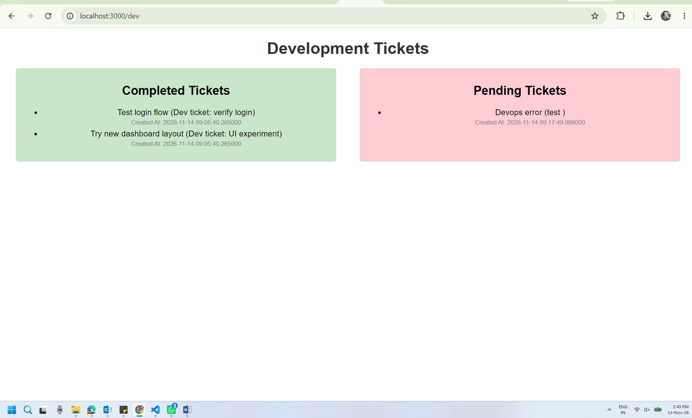
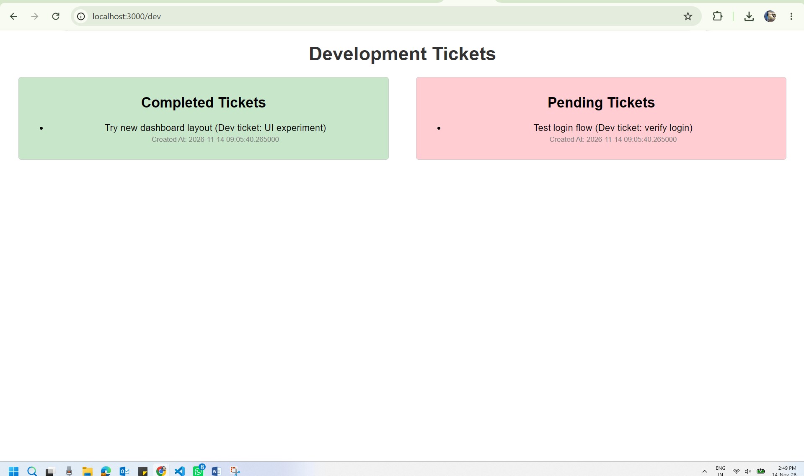
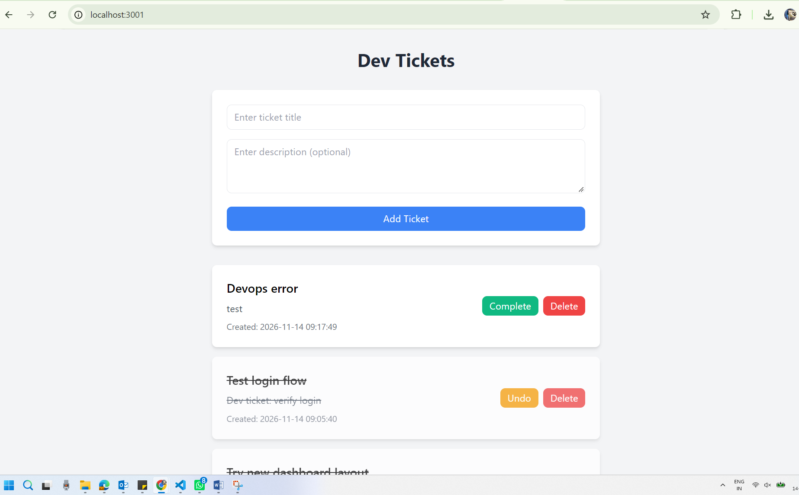
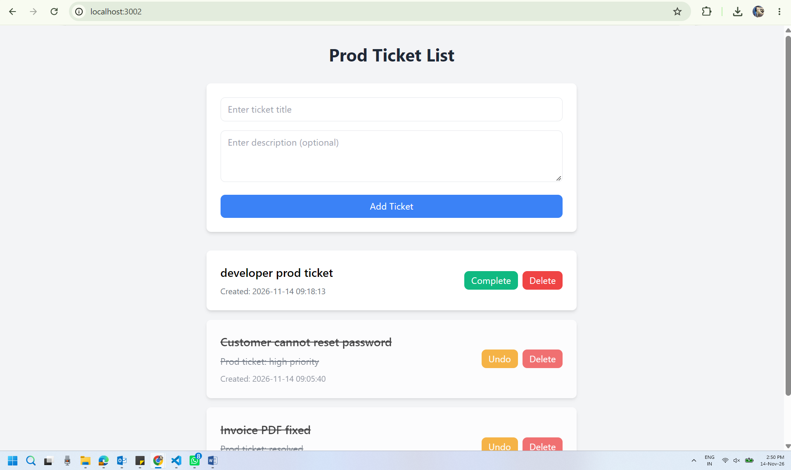
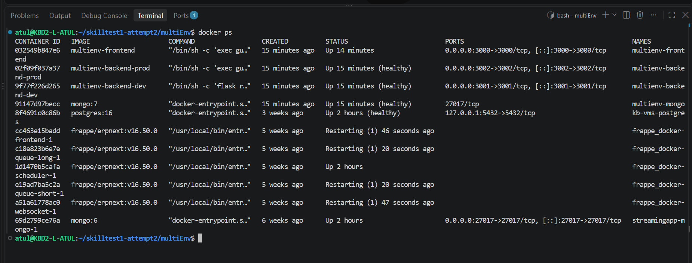
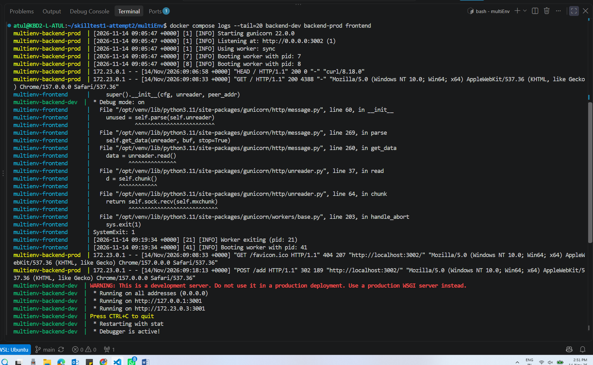
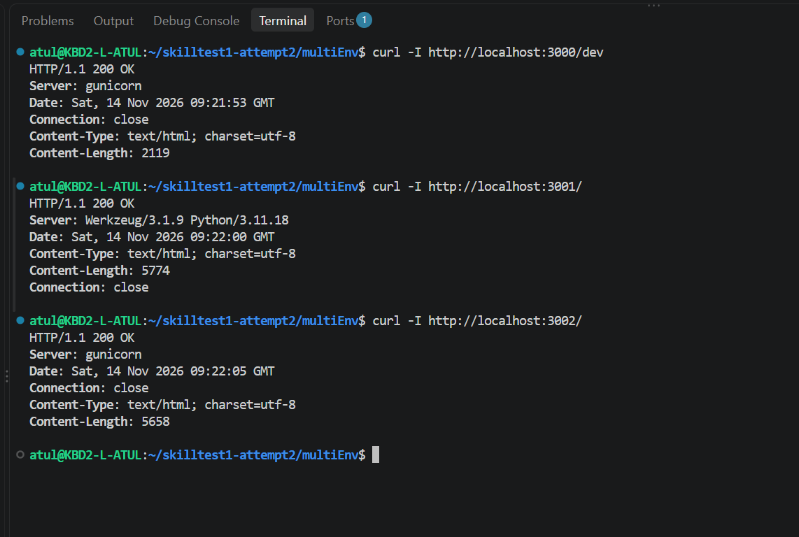
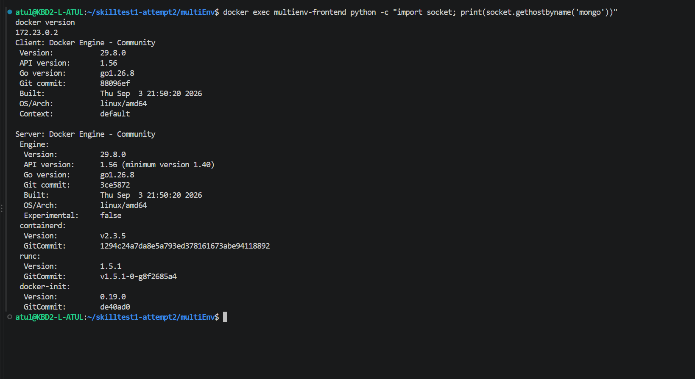
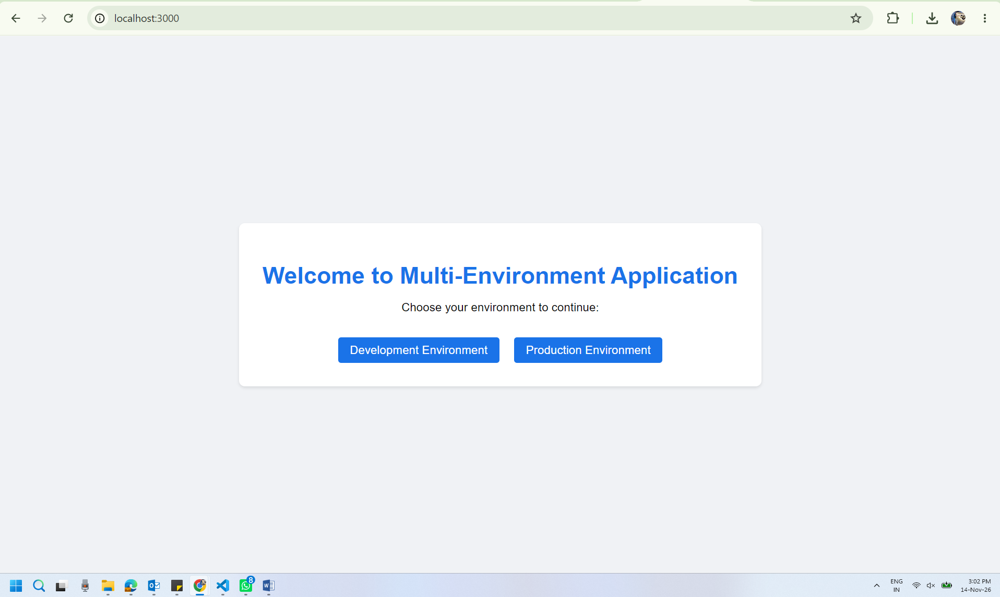
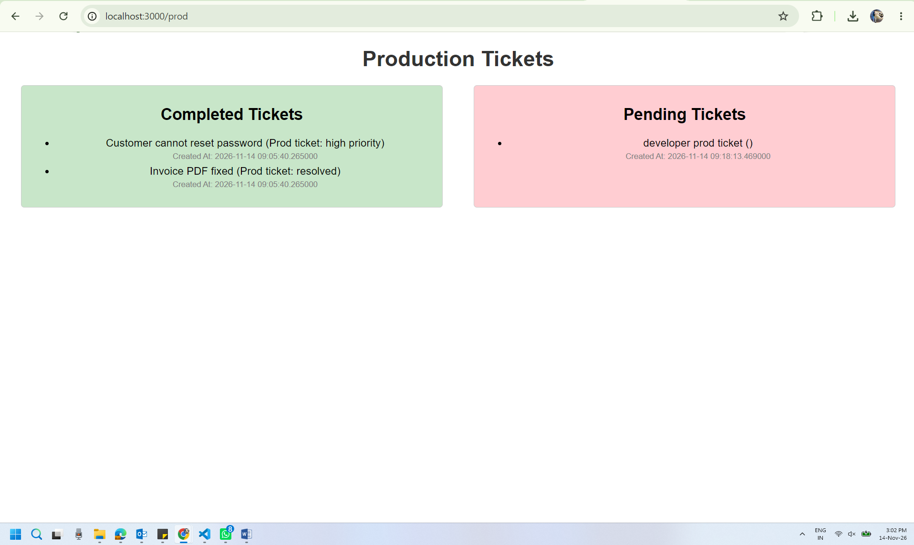

# Multi-Environment Ticket Management: Docker Deployment

Three Flask services plus MongoDB, deployed with Docker Compose.

- **Frontend (Flask + Jinja):** read-only view of the dev and prod tickets.
- **Backend dev (Flask):** add / complete / delete tickets in the `dev` database.
- **Backend prod (Flask):** add / complete / delete tickets in the `prod` database.
- **MongoDB:** one container holding two databases, `dev` and `prod`.

## Architecture & Ports

| Service      | Container              | Host port | Server           | Database used |
|--------------|------------------------|-----------|------------------|---------------|
| Frontend     | multienv-frontend      | 3000      | gunicorn         | `dev` and `prod` (read) |
| Backend dev  | multienv-backend-dev   | 3001      | flask run (debug)| `dev` |
| Backend prod | multienv-backend-prod  | 3002      | gunicorn         | `prod` |
| MongoDB      | multienv-mongo         | not published | mongod 7     | volume `mongo-data` |

All services share the `multienv-net` bridge network and reach MongoDB by the service name `mongo`.

## Access URLs

| What | URL |
|---|---|
| Frontend dashboard | http://localhost:3000 |
| Development environment | http://localhost:3000/dev |
| Production environment | http://localhost:3000/prod |
| Dev backend (add/edit tickets) | http://localhost:3001 |
| Prod backend (add/edit tickets) | http://localhost:3002 |

Tickets added on the backends (3001 / 3002) appear on the frontend (`/dev` / `/prod`) because they share the same database.

## Prerequisites

- Docker Engine and Docker Compose v2 (`docker --version`, `docker compose version`)
- Ports 3000, 3001, 3002 free
- Internet access for the first build (pulls images and Python packages)

## Quick Start

```bash
cd Cloud-and-Containers
docker compose up --build -d
docker compose ps
```

## Step-by-Step Deployment

1. **Environment:** Windows 11 with WSL2 (Ubuntu), VS Code (WSL extension), Docker 29.x. Record with `docker version`, `docker info`, `wsl -l -v`.
2. **Project layout** matches the assignment: `backend/dev`, `backend/prod`, `frontend`, each with `Dockerfile`, `requirements.txt` and `.env`, plus `docker-compose.yml` at the root.
3. **Build and start:** `docker compose up --build -d`
4. **Check containers:** `docker ps` (all four `Up`, services `healthy`).
5. **Check logs:** `docker compose logs --tail=30` (or `docker compose logs -f frontend`).
6. **Connectivity tests:**
   ```bash
   curl -I http://localhost:3000/
   curl -I http://localhost:3000/dev
   curl -I http://localhost:3000/prod
   curl -I http://localhost:3001/
   curl -I http://localhost:3002/
   # inter-container: frontend resolving mongo by service name
   docker exec multienv-frontend python -c "import socket; print(socket.gethostbyname('mongo'))"
   ```
7. **Functional test:** open http://localhost:3001, add a ticket, then open http://localhost:3000/dev and confirm it appears as Pending. Click Complete and refresh `/dev` to see it under Completed. Repeat for prod (3002 and `/prod`).

### Stop / reset

```bash
docker compose down          # stop, keep data
docker compose down -v       # stop and delete the database volume
```

## Configuration (environment variables)

| File | Variables |
|---|---|
| `backend/dev/.env` | `PORT=3001`, `MONGO_URI=mongodb://mongo:27017/dev` |
| `backend/prod/.env` | `PORT=3002`, `MONGO_URI=mongodb://mongo:27017/prod` |
| `frontend/.env` | `PORT=3000`, `DEV_DB_URI=mongodb://mongo:27017`, `PROD_DB_URI=mongodb://mongo:27017` |

The files are loaded into containers with `env_file` in `docker-compose.yml` (they are excluded from the images by `.dockerignore`). To use MongoDB Atlas instead of the local container, replace the URIs; the backend URIs must include the database name.

## Docker design notes (for VIVA)

- **Dev backend:** `flask run --debug` for auto-reload and debug logs.
- **Prod backend:** gunicorn with 2 workers, non-root user, access/error logs to stdout.
- **Frontend:** multi-stage build; dependencies are built in a venv in stage 1 and only the venv and code are copied into a slim final image; runs as non-root.
- **Ports:** the original `app.run()` defaults to 5000, so the ports 3000/3001/3002 are set through `${PORT}` in the container start command.
- **Startup order:** `depends_on` with health checks (mongo healthy, then backends, then frontend).
- **Persistence:** named volume `mongo-data`; `mongo-init/seed.js` loads sample tickets on first start only.

## Assumptions and Limitations

- Application code is from https://github.com/mohanDevOps-arch/MultiEnv_App. The repo had no `requirements.txt` or Dockerfiles; they were added. `Flask-PyMongo` was added since the code imports it but the original README did not list it. Newer Flask 3 / PyMongo 4 versions are pinned instead of Flask 2.0.1, which is incompatible with current Werkzeug.
- A local MongoDB container is used instead of Atlas so the project runs without external accounts. MongoDB has no authentication and its port is not published (acceptable for a local demo only).
- Ports 5000/5001/5002 in the original README are replaced with 3000/3001/3002 as required by the assessment.
- The frontend page is read-only; ticket creation happens on the backend ports.

## Troubleshooting

| Symptom | Fix |
|---|---|
| `port is already allocated` | `docker ps` to find the conflict, or `docker compose down`, then retry |
| `Cannot connect to the Docker daemon` (WSL) | Start Docker Desktop, or `sudo service docker start` |
| Backend page shows Internal Server Error | `docker compose logs backend-dev`; check `MONGO_URI` includes the db name and mongo is healthy |
| `/dev` empty | Seed runs only on first start; add a ticket on port 3001 or reset with `docker compose down -v` then `up` |
| `ModuleNotFoundError: flask_pymongo` | Confirm `Flask-PyMongo` is in `requirements.txt`, rebuild with `--build` |
| Stale code after editing | `docker compose up --build -d` |
| Windows line-ending problems | `sed -i 's/\r$//' <file>` |

## Evidence


## Screenshots











